# DuoLab

Layout options for iPhone Duo, side by side, with verdicts.

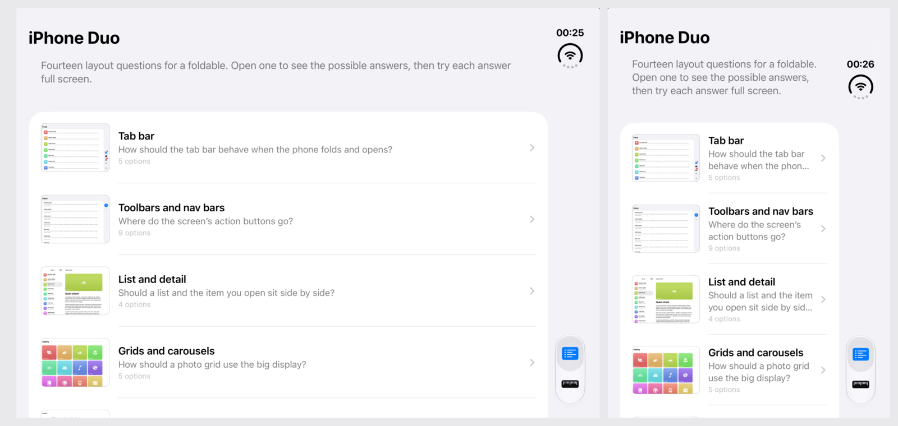

## Topics

| | |
|---|---|
| 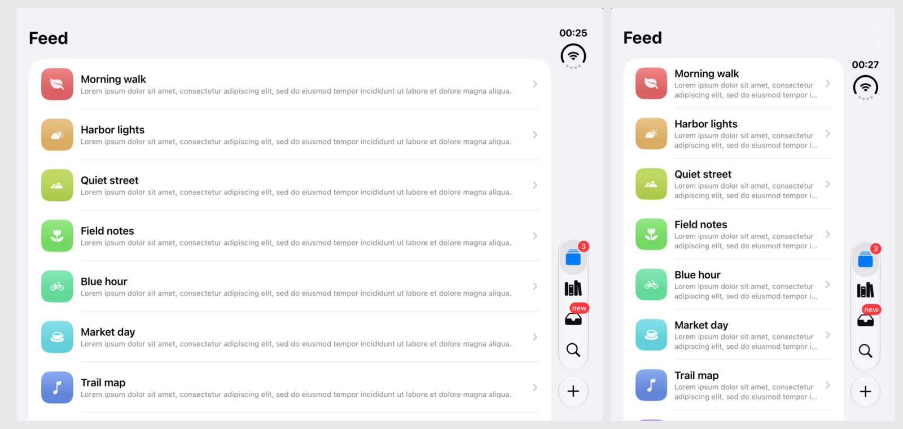 **Tab bar** | 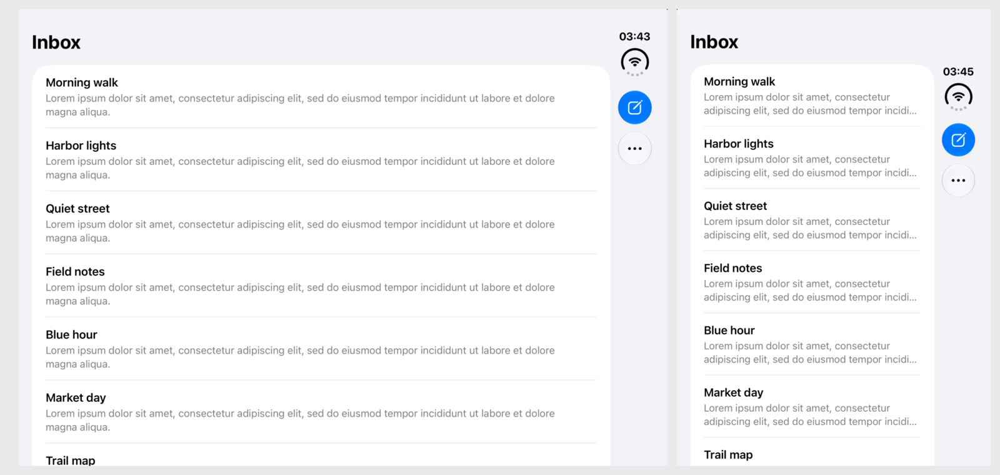 **Toolbars** |
| 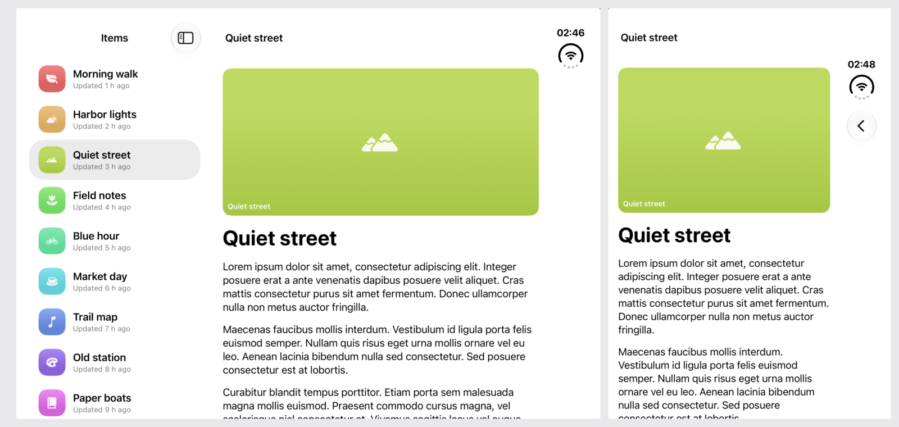 **List and detail** | 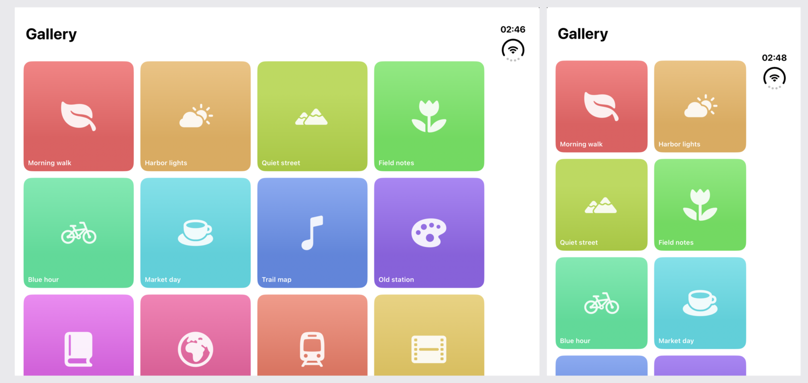 **Grids** |
| 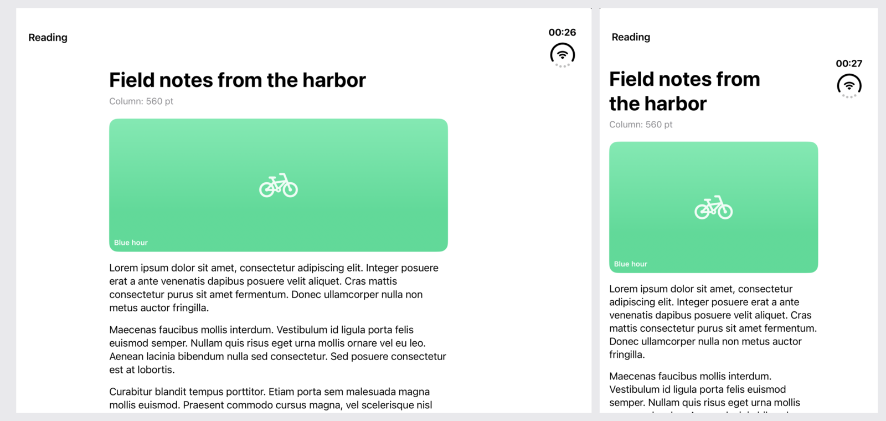 **Reading width** | 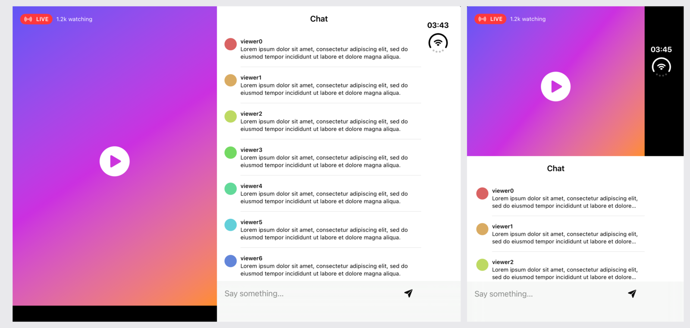 **Media** |
| 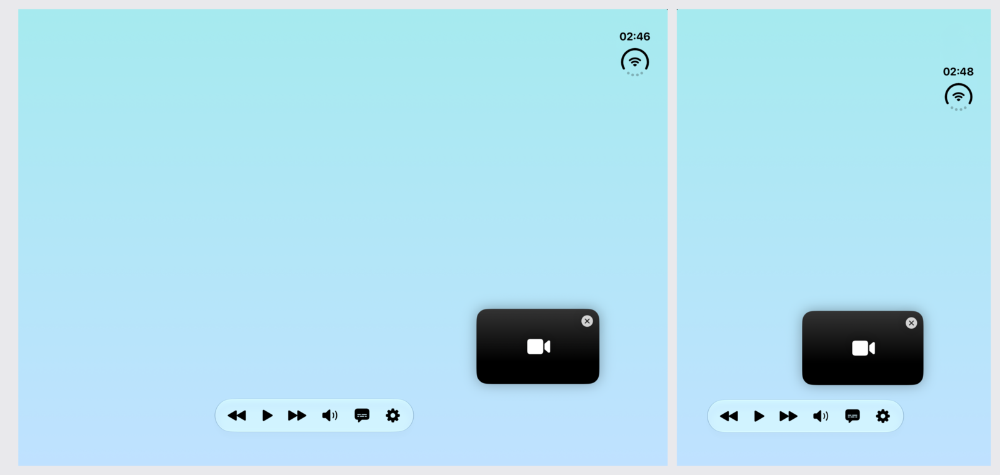 **Floating overlays** | 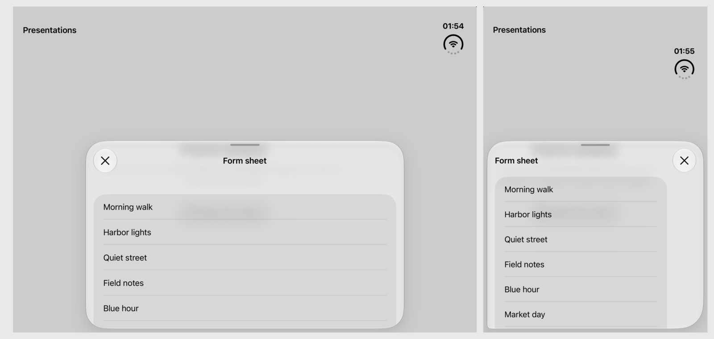 **Presentations** |
| 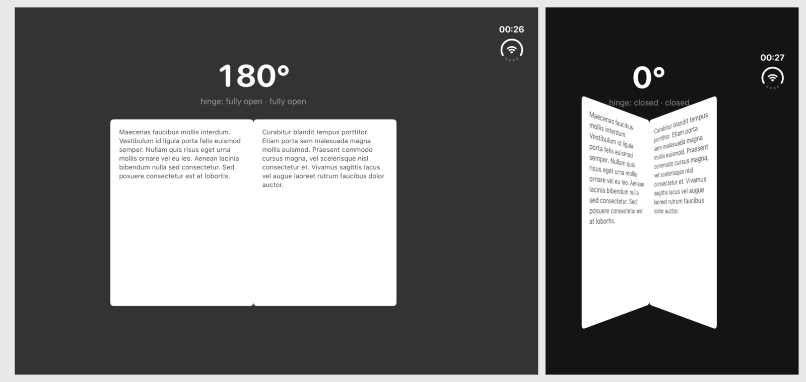 **Hinge** | 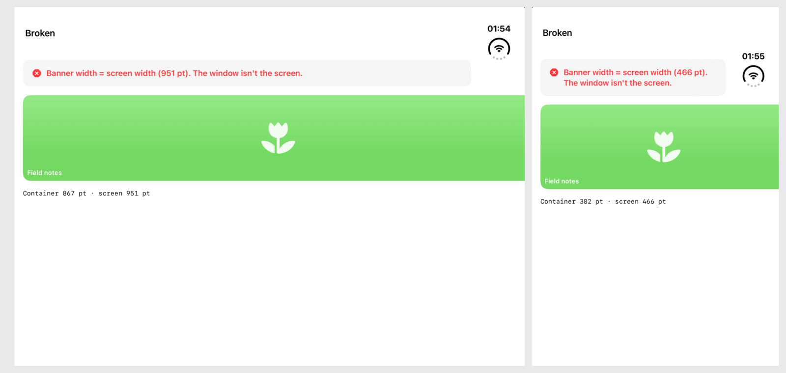 **Pitfalls** |
| 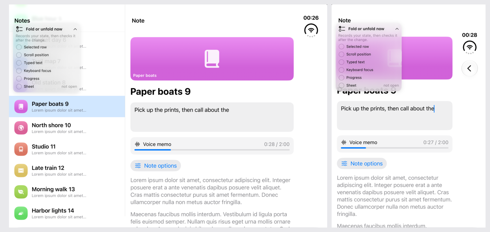 **Fold mid-task** | 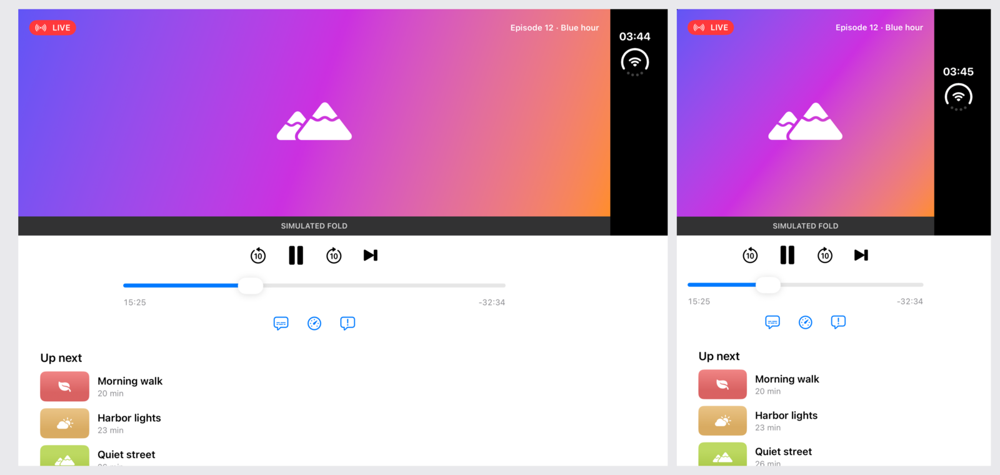 **Laptop pose** |
| 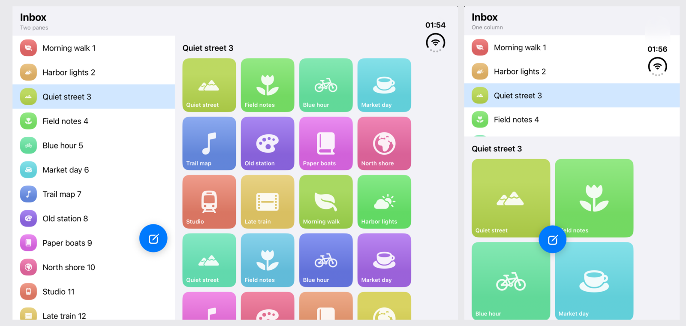 **Motion on fold** | 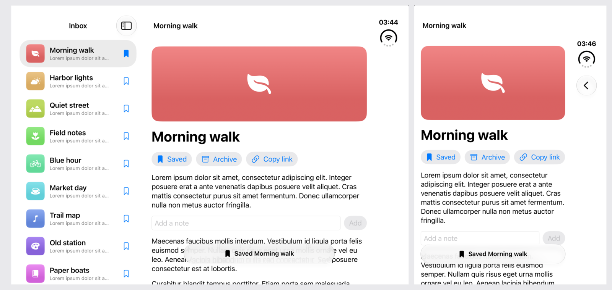 **Toasts** |
| 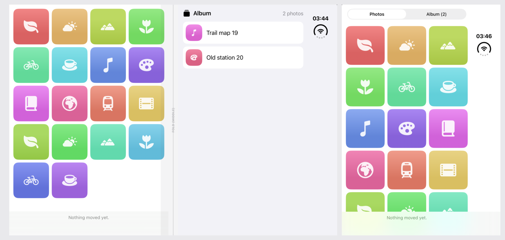 **Two panes and drag** | 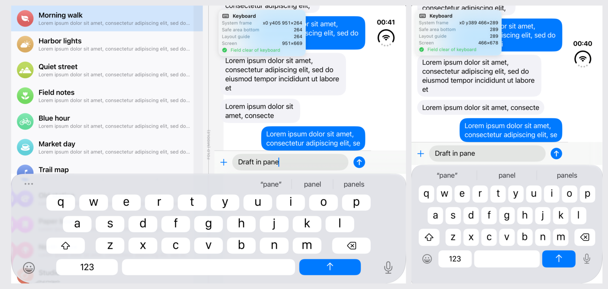 **Keyboard** |
| 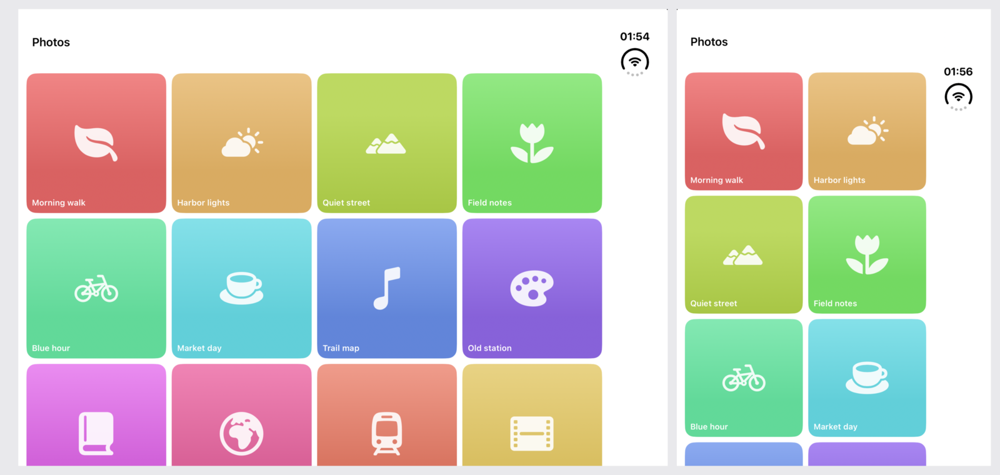 **Transitions** | 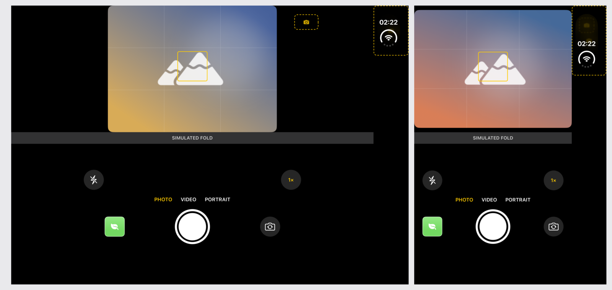 **Camera** |
| 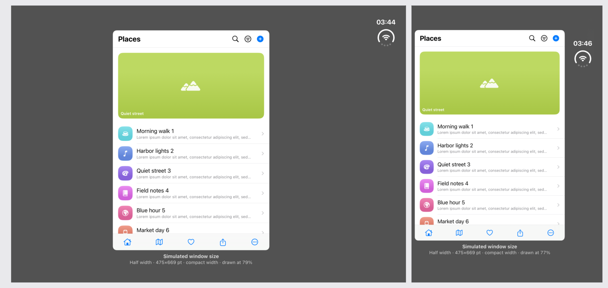 **Small windows** | |

Verdicts: Recommended, Worth a try, Avoid, Built in. Sources: Apple's guidance, other foldables, simulator measurements. The **i** button shows the reasoning and the API.

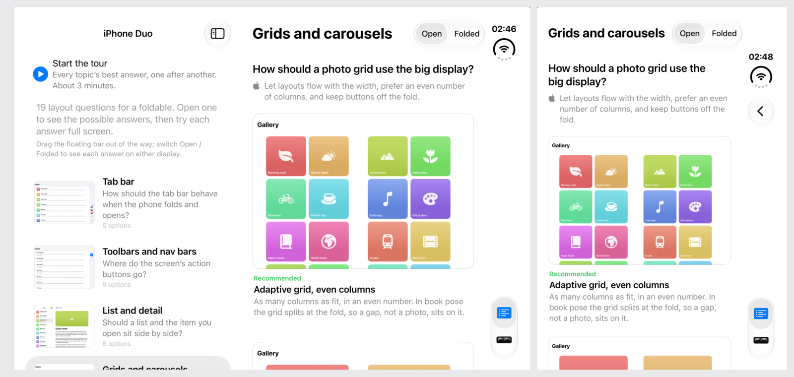

## The tour

Plays each topic's recommended option. **Compare** shows it beside the one to avoid.

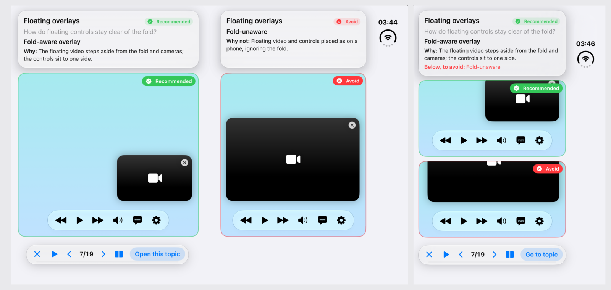

## Simulator findings

- Inner display is regular × regular.
- Status bar and cameras sit in an 84 pt side strip.
- The fold is reported only when half open.
- The tab bar stays vertical in that strip.
- Tab bar minimize-on-scroll has no effect.
- Three-column split views show two columns.
- Toolbar items move into the strip when folded.
- The keyboard splits around the fold in book pose.
- Sheets never span the fold.
- The simulator can't produce laptop pose.

## Docs

| | |
|---|---|
| [Principles](docs/00-principles.md) | Twelve rules |
| [Pose and continuity](docs/01-pose-and-continuity.md) | State across folds, laptop and book pose |
| [Navigation](docs/02-navigation-and-hierarchy.md) | Tab bar, sidebar, split views, Back |
| [Presentations and feedback](docs/03-presentations-and-feedback.md) | Sheets, popovers, menus, toasts |
| [Motion](docs/04-motion-and-animation.md) | Animating a fold, Reduce Motion |
| [Input and ergonomics](docs/05-input-and-ergonomics.md) | Reach, keyboard, drag, camera |
| [Competitor patterns](docs/06-competitor-patterns.md) | Samsung, Google, Microsoft |
| [Findings](docs/08-findings.md) | Measured behavior |
| [Lab backlog](docs/07-lab-backlog.md) | Next topics |
| [Facts](research/apple-foldable-facts.md) · [Tab bar facts](research/native-tabbar-liquid-glass-facts.md) · [Measurements](research/on-device-measurements.md) · [Checklist](CHECKLIST.md) | Reference |
