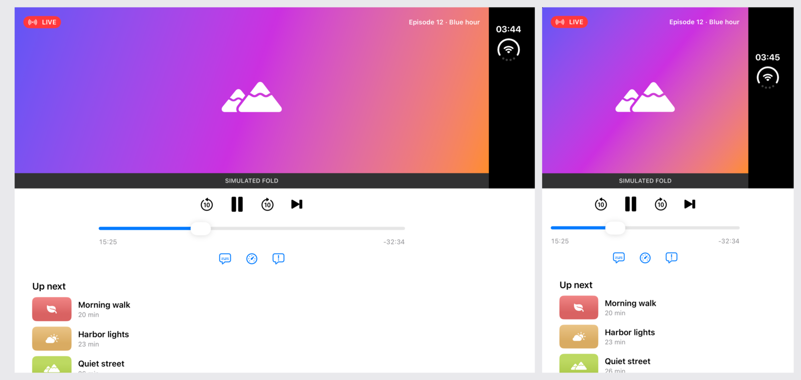

# 06 · Competitor patterns: Samsung, Google, Microsoft

Researched 2026-11-02. All rows are **secondary** (non-Apple) unless the "iOS equivalent" column cites
Apple. Several Microsoft sources are archived (Surface Duo docs moved to `previous-versions`) and
several Samsung pages date from the Z Fold2/Flip era; the patterns are stable, the API names are not.

## What we do in DuoLab and why

Apple's guidance for Duo is short and mostly about layout. Android foldables have six years of
patterns for postures, panes and continuity. This table sorts them into three buckets: **Apple already
does it** (show the Apple way, don't port), **Apple allows it and is silent** (DuoLab should
demonstrate it, it's where teams need help), and **doesn't fit Duo** (say so, so nobody builds it).
The "DuoLab?" column feeds `07-lab-backlog.md`.

## The table

| # | Pattern | Who | Their rationale | iOS 27.1 equivalent | DuoLab? |
|---|---|---|---|---|---|
| 1 | **Flex mode / tabletop: view on top, controls on the bottom** | Samsung ([Flex mode](https://developer.samsung.com/one-ui/foldable-and-largescreen/foldable-excl-flex.html)), Google ([fold-aware](https://developer.android.com/develop/ui/compose/layouts/adaptive/foldables/make-your-app-fold-aware)) | hands-free media, camera, video calls; the flat half is a stable touch surface | Yes: `ArrangementView(.overlay)` puts secondary top, primary bottom when folded in portrait ([doc](https://developer.apple.com/documentation/swiftui/overlayarrangementviewstyle), verified); Apple recommends it as optional ([111466](https://developer.apple.com/videos/play/tech-talks/111466/), verified) | **Yes: lab 12 Laptop pose** (was B2). Apple allows it and gives the API but shows no full example. Simulated fold only; the simulator has no laptop pose. |
| 2 | Flex mode panel: system adds a touchpad/controls panel for apps that don't adapt | Samsung ([support](https://www.samsung.com/ae/support/mobile-devices/how-many-apps-support-flex-mode-on-the-galaxy-z-fold-6/)) | keeps old apps usable half-folded | None found (unverified) | **No.** System feature, nothing for an app to demo. Lab 12's "Same layout everywhere" is the "don't adapt" case. |
| 3 | Visual transition when entering/leaving Flex mode ("strongly recommended") | Samsung | orientation: people track what moved | No API rule; standard SwiftUI animation | **Yes: lab 13 Motion on fold** (was B4). Apple is silent; teams need a default. |
| 4 | Keep camera preview ratio/shape across modes | Samsung, Google ([Foldables_Camera](https://developer.android.com/docs/quality-guidelines/adaptive-app-quality/experiences/foldables)) | distorted previews look broken | `dynamicAspectRatio`, rotation coordinator ([111465](https://developer.apple.com/videos/play/tech-talks/111465/), verified) | **Partly (B15)** as a layout with a placeholder; real camera can't run in the sim. |
| 5 | Not every screen adapts to Flex mode (e.g. settings lists) | Samsung | effort where it pays | consistent with Apple "Move only what's necessary" (verified) | **Yes**, as lab 12's "Same layout everywhere" (Consider; fine for lists). |
| 6 | Book posture = reading, two-page layout | Google, Microsoft "two page" ([walkthrough](https://devblogs.microsoft.com/surface-duo/dual-screen-app-design-walkthrough)) | feels like a real book | Apple: scrolling content doesn't displace (verified, [111463](https://developer.apple.com/videos/play/tech-talks/111463/)) | **Already** as an effect (lab 09 "Book pages"). Keep it an effect; don't make it the reading default. |
| 7 | Canonical **list-detail** with explicit collapse/expand rules (detail survives narrowing; list highlights selection on widening; placeholder detail) | Google ([canonical layouts](https://developer.android.com/develop/ui/compose/layouts/adaptive/canonical-layouts)) | state preserved across size changes | `NavigationSplitView` + `preferredCompactColumn` (verified API) | **Yes (B3, in progress, round 3).** Apple leaves the fold moment implicit. |
| 8 | **Supporting pane** (~70/30, secondary meaningless alone) | Google | context next to main content | `ArrangementView(.split)` + `splitArrangementLayoutRatio` (verified API) | **Yes**, as a new option in lab 06 media ("Transcript beside player", Apple's own Podcasts example, [111463](https://developer.apple.com/videos/play/tech-talks/111463/)). |
| 9 | **Feed** grid with adaptive columns (min item width) | Google | one layout for every width | `LazyVGrid(.adaptive)` | **Already** (lab 04). Add the even-columns-when-folded rule (Apple, verified). |
| 10 | Wider gutter at the hinge in multi-pane layouts | Google ([postures](https://developer.android.com/design/ui/mobile/guides/layout-and-content/postures-and-orientation)) | content doesn't get lost in the hinge | Apple: increase spacing around the hinge, keep outer margins (Fitness example, [111463](https://developer.apple.com/videos/play/tech-talks/111463/), verified); split views do it automatically | **Already** (lab 04, lab 07). |
| 11 | Navigation rail instead of bottom bar on large screens and cover screens | Google ([Tier 2](https://developer.android.com/docs/quality-guidelines/adaptive-app-quality/tier-2)) | ergonomics, avoids cutouts | System vertical tab bar in the rail (verified) | **No.** The system does it; lab 01 shows it. |
| 12 | Bottom sheets / buttons / text fields not full width on large screens | Google ([Tier 2](https://developer.android.com/docs/quality-guidelines/adaptive-app-quality/tier-2)) | stretched controls look broken | `presentationSizing(.form/.page)`, readable width (verified API) | **Already** (labs 05, 08). |
| 13 | Filter sheet becomes a **side sheet** on wide screens | Google ([postures](https://developer.android.com/design/ui/mobile/guides/layout-and-content/postures-and-orientation)) | keeps context visible | `presentationPlacement(.leading/.trailing)` (verified API, iOS 27.0) | **Yes (B11, in progress, round 3).** New API, no Apple example. |
| 14 | State continuity checklist: scroll, text + keyboard, playback, combinations of rotate + fold | Google ([Tier 3](https://developer.android.com/docs/quality-guidelines/adaptive-app-quality/tier-3)), Samsung ([continuity](https://developer.samsung.com/one-ui/largescreen-and-foldable/designing_for_foldable.html)), Pixel ([guide](https://android-developers.googleblog.com/2023/06/pixel-fold-and-pixel-tablet-developers-guide.html)) | lost state looks like a crash | Apple states the principle only (verified HIG) | **Yes: lab 11 Fold mid-task** (was B1). |
| 15 | User setting "continue apps on cover screen: Always / Swipe to continue / Never" | Samsung ([SamMobile](https://www.sammobile.com/news/control-how-apps-behave-when-you-fold-your-samsung-galaxy-z-fold-8/)) | privacy, accidental folds | None found (unverified) | **No.** Not an app decision. |
| 16 | Snackbar confined to one screen, targetable (first/second/both) | Microsoft ([snackbar](https://devblogs.microsoft.com/surface-duo/snackbar-dual-screen/)) | never under the hinge; show where the user is focused | No toast component; alerts move with pose (verified) | **Yes: lab 14 Toasts and banners** (was B5); "Pill in the pane" keeps it in one pane and off the fold. |
| 17 | Dialogs on one screen when spanned, anchorable | Microsoft ([Flutter popups](https://learn.microsoft.com/en-us/dual-screen/flutter/hinge-aware-popup-routes)) | don't split a dialog over the seam | System alerts/sheets avoid the fold automatically (verified) | **No new lab;** lab 08 already shows the system doing it. |
| 18 | **Dual view**: same data in two forms (map + list) on two screens | Microsoft ([walkthrough](https://devblogs.microsoft.com/surface-duo/dual-screen-app-design-walkthrough)) | cross-reference; "a single point of truth should be used" | two-pane split sharing one model | **Consider (B10, in progress, round 3).** Good demo of shared state; not Apple-blessed. |
| 19 | **Companion pane** (canvas + tools) | Microsoft | editing, game controls | `ArrangementView(.split)` or inspector | **Fold into item 8**; same mechanics. |
| 20 | **Extended canvas** across both screens (maps, drawing) | Microsoft | more room | full-width content, with `backgroundExtensionEffect` under bars (verified API) | **No new lab.** On Duo this is just "use the width"; covered by labs 04/06. |
| 21 | One screen as a keyboard | Microsoft ([device modes](https://learn.microsoft.com/en-us/previous-versions/dual-screen/design/postures)) | laptop-style typing | system keyboard occupies the bottom half in laptop pose (secondary, [MacRumors](https://www.macrumors.com/2026/10/26/iphone-duo-is-apples-tiniest-laptop/)) | **Partly (B14, in progress, round 3)**: capture where your composer ends up. |
| 22 | Rear-display / dual-screen camera preview (show the subject a preview on the outer screen) | Google (rear display mode), Samsung (cover screen preview) | rear-camera selfies, showing the subject | `CameraCaptureAccessory` (verified, [111464](https://developer.apple.com/videos/play/tech-talks/111464/)) | **No** (needs a camera session; sim can't). BuildNotes only. |
| 23 | Don't lock portrait; "can look like a bug" | Google ([postures](https://developer.android.com/design/ui/mobile/guides/layout-and-content/postures-and-orientation)), Pixel guide | letterboxing | Inner display ignores supported orientations (verified, [111461](https://developer.apple.com/videos/play/tech-talks/111461/)) | **Already** (lab 10). |
| 24 | Exact hinge angle is not exposed; tune per device | Google | sensor variance | Apple exposes `angle` (verified) | **Yes, as hygiene:** lab 09's "Angle drives the effect only", "Light tap at each pose" and "With Reduce Motion" (was B9). |
| 25 | Picture-in-picture / multi-instance must work folded and unfolded | Google ([Foldables quality](https://developer.android.com/docs/quality-guidelines/adaptive-app-quality/experiences/foldables)) | multitasking | PiP pinned to top, apps resize vertically; multiple scenes inner-only (verified, [111464](https://developer.apple.com/videos/play/tech-talks/111464/), [111466](https://developer.apple.com/videos/play/tech-talks/111466/)) | **Consider (B12)**: a "short window" preview (app resized by pinned PiP). |

## Takeaways

1. **The tabletop pattern is the one real export.** Every platform has it, Apple endorses it and ships
   the container, and nobody has a clean iOS demo yet. DuoLab now has one (lab 12), drawn on a
   simulated fold because the simulator can't produce the pose.

   
   *Lab 12 "Video up, controls down": Samsung's "view on top, control on the bottom", built with the overlay arrangement on a simulated laptop fold.*
2. **Google's continuity tests are more concrete than Apple's.** Borrow them verbatim as DuoLab's
   "fold mid-task" checklist. Lab 11 does: its checklist overlay ticks selection, scroll, text, focus,
   progress and sheet after each fold.
3. **Microsoft's spanning patterns mostly don't transfer.** They were built around a hard seam between
   two screens; Duo has one flexible panel whose fold is only active in book or laptop pose.
4. **Toasts are a genuine gap on every platform.** Only Microsoft wrote fold-specific rules (one screen,
   where the user is focused). That plus Apple's alert behaviour is enough to define DuoLab's rules.

## Sources

**Apple says** (verified): see the iOS-equivalent column; main pages are the
[HIG](https://developer.apple.com/design/human-interface-guidelines/designing-for-iphone-duo),
[Preparing doc](https://developer.apple.com/documentation/technologyoverviews/preparing-your-app-for-iphone-duo),
tech talks [111461](https://developer.apple.com/videos/play/tech-talks/111461/)–[111466](https://developer.apple.com/videos/play/tech-talks/111466/).

**Others do** (secondary)
- Samsung: [Flex mode](https://developer.samsung.com/one-ui/foldable-and-largescreen/foldable-excl-flex.html), [Designing for foldables](https://developer.samsung.com/one-ui/largescreen-and-foldable/designing_for_foldable.html), [Flex mode panel](https://www.samsung.com/ae/support/mobile-devices/how-many-apps-support-flex-mode-on-the-galaxy-z-fold-6/), [continuity setting (SamMobile)](https://www.sammobile.com/news/control-how-apps-behave-when-you-fold-your-samsung-galaxy-z-fold-8/)
- Google: [fold-aware](https://developer.android.com/develop/ui/compose/layouts/adaptive/foldables/make-your-app-fold-aware), [canonical layouts](https://developer.android.com/develop/ui/compose/layouts/adaptive/canonical-layouts), [postures and orientation](https://developer.android.com/design/ui/mobile/guides/layout-and-content/postures-and-orientation), [adaptive quality](https://developer.android.com/docs/quality-guidelines/adaptive-app-quality) ([Tier 3](https://developer.android.com/docs/quality-guidelines/adaptive-app-quality/tier-3), [Tier 2](https://developer.android.com/docs/quality-guidelines/adaptive-app-quality/tier-2), [Foldables](https://developer.android.com/docs/quality-guidelines/adaptive-app-quality/experiences/foldables)), [Pixel Fold guide](https://android-developers.googleblog.com/2023/06/pixel-fold-and-pixel-tablet-developers-guide.html)
- Microsoft: [design walkthrough](https://devblogs.microsoft.com/surface-duo/dual-screen-app-design-walkthrough), [device modes (archived)](https://learn.microsoft.com/en-us/previous-versions/dual-screen/design/postures), [snackbar](https://devblogs.microsoft.com/surface-duo/snackbar-dual-screen/), [Flutter popups](https://learn.microsoft.com/en-us/dual-screen/flutter/hinge-aware-popup-routes)

**We think** (our view): every "DuoLab?" verdict and the four takeaways.
